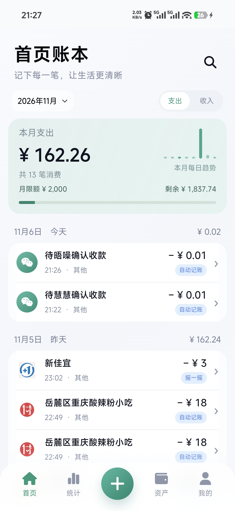
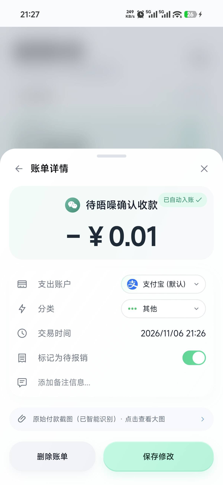
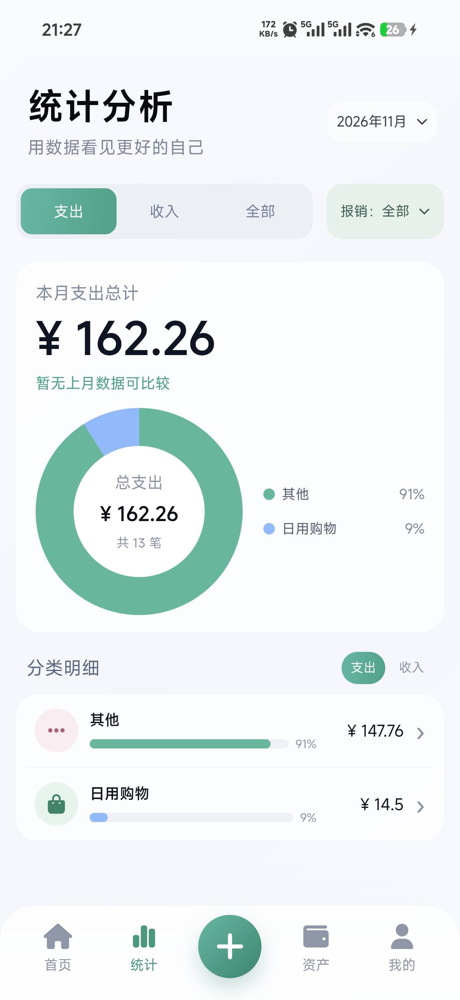
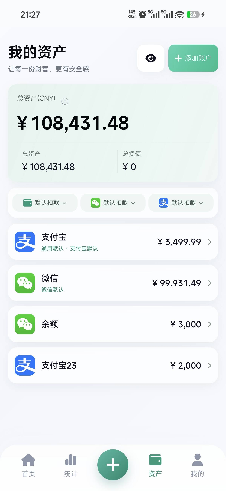
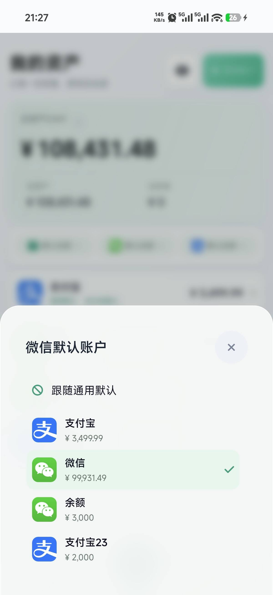
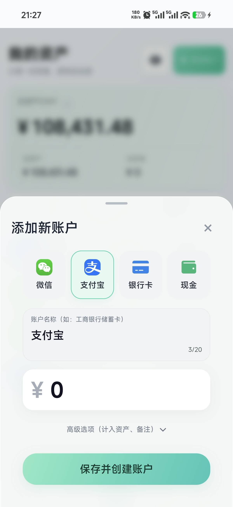
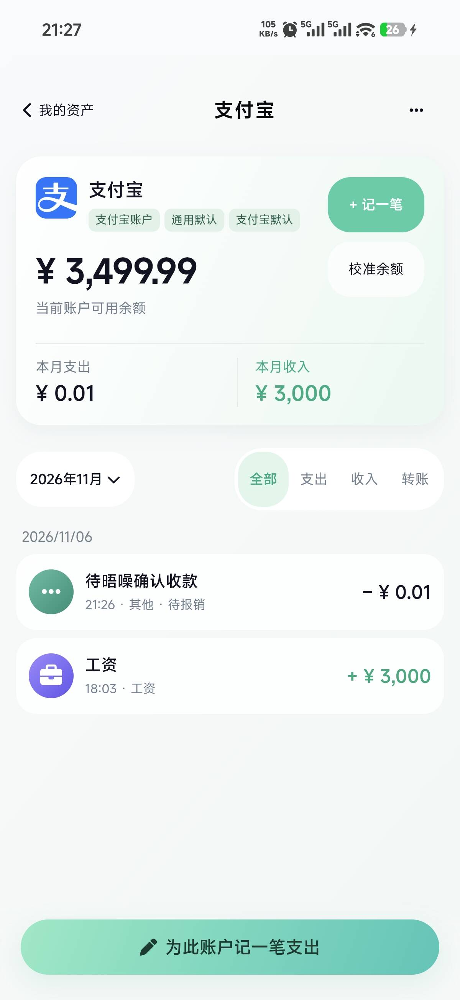
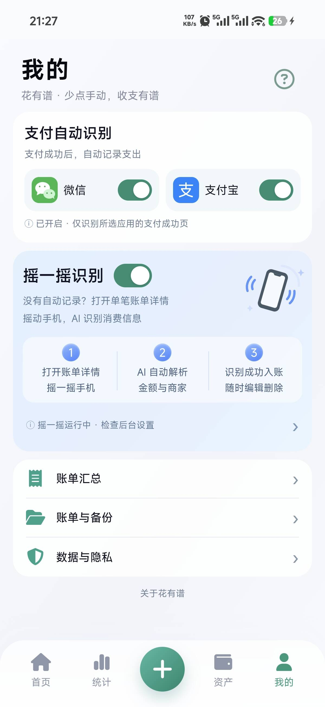
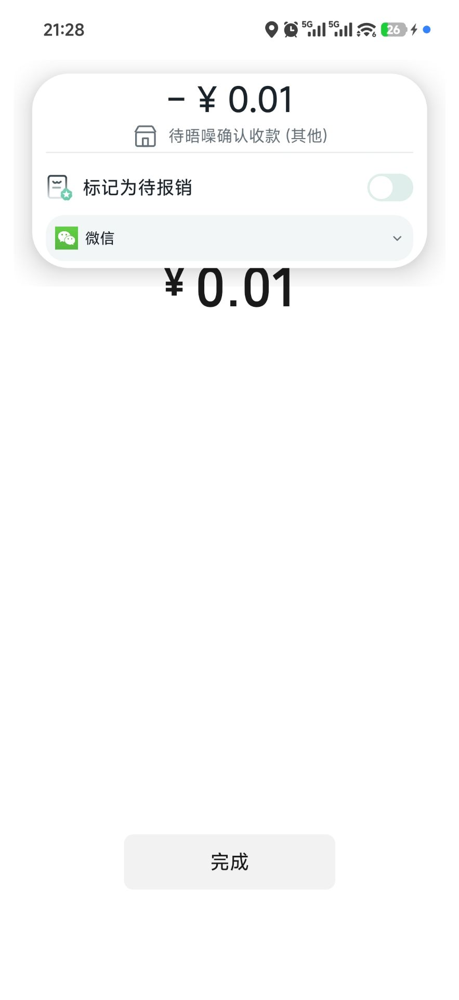

# 【开源自荐 / 版本更新】花有谱：付款后自动记账，预算、账户与账单汇总也补上了

之前分享过自己做的本地记账 App「花有谱」。起因还是存不住钱，想看看每个月的钱到底花在哪儿，但每次付款后再手动记一遍，实在坚持不下来。

所以核心思路没变：**付款后利用现成的支付成功页，把账顺手记下来，少一点操作。** 无障碍负责检查当前页面，内置 OCR 提取商户、金额等信息，在本机完成识别和入账。不需要配置模型，不依赖短信或其他 App 的通知监听，也不需要账号和服务器。

项目地址：<https://github.com/AldenHe/huayoupu-ledger>

下载安装：<https://github.com/AldenHe/huayoupu-ledger/releases/latest>

## 先说清楚：目前哪些场景能记？

| 付款场景 | 支持情况 |
| --- | --- |
| 微信扫码付款、商户付款 | ✅ 展示受支持的微信支付成功页时，自动记账。 |
| 微信转账 | ✅ 支持付款方的转账成功页，不用等对方确认收款。 |
| 支付宝扫码付款、商户付款、转账 | ✅ 展示受支持的支付 / 转账成功页时，自动记账。 |
| 外卖、购物等第三方 App 拉起微信 / 支付宝付款 | ✅ 付款后展示受支持的微信 / 支付宝成功页，同样能自动记录。 |
| 地铁、公交等出行扣费 | ✅ 可以记账；有受支持的成功页时自动记录，没有成功页时打开单笔账单详情摇一摇补录。 |
| 协议代扣、历史账单、没有成功页的付款 | 🔄 打开单笔账单详情摇一摇，或导入截图、手动补记。 |
| 微信红包 | ❌ 暂不支持自动识别记账。 |

**判断依据是付款后的页面，不只是“用了微信或支付宝”。** 密码、验证、不可读取或禁止截图的页面会跳过；收款、红包领取、聊天消息也不属于自动支出采集范围。不同支付 App 版本和手机系统仍可能需要适配，漏记时可以主动补录。

## 这次更新了什么？

相对之前发布的 **0.5.88-v6**，这次 **0.5.113-v6** 主要增加了这些：

1. **月度预算**：首页直接看本月预算、已花多少、还剩多少。
2. **标签和待报销**：账单可以打标签、标记待报销，后续按条件查找和整理。
3. **账单汇总与导出**：按日期、分类、标签等条件汇总，支持 PNG、Excel，以及 PDF 与图片凭证材料包。
4. **账户管理补齐**：账单关联账户后联动调整余额，可查看账户收支明细、校准余额、进行账户间转账。
5. **微信 / 支付宝默认账户**：除了通用默认账户，还能分别设置微信和支付宝的入账账户；识别完成后也能在结果卡片直接改账户、标记待报销。
6. **页面和反馈更新**：首页、账单详情、统计筛选、资产页面和弹窗做了一轮调整；没有灵动岛的环境直接显示完整记账结果卡片，减少重复提示。
7. **识别细节优化**：继续改善商户文字、交通出行等账单的解析与去重体验。

## 当前页面

前端仍通过自己做的 Agent 工作台，根据 UI 原型生成 HTML，再接入 Android 本地记账与识别能力。这次也把页面截图更新成了当前版本的手机实机画面。

| 首页与预算 | 账单详情 | 统计分析 |
| :---: | :---: | :---: |
|  |  |  |

| 资产账户 | 微信默认账户 | 添加账户 |
| :---: | :---: | :---: |
|  |  |  |

| 账户明细 | 设置 |
| :---: | :---: |
|  |  |

| 记账结果卡片 | 记账结果卡片展示 |
| :---: | :---: |
|  |  |

OCR 继续使用内置 **PP-OCRv6 Tiny**，做了运行库裁剪、内存控制和账单解析调优，**没有进行模型权重微调训练**。之前提到的 20.44 MiB 和约 400–500 ms 来自历史独立研究包、模拟器的特定测试，不代表当前安装包大小或手机上的完整记账耗时。当前包体以 Release 文件为准。

支持 **Android 11+ ARM64**。数据留在本机，换手机或卸载前记得导出完整备份。原生实时通知 / 灵动岛的展示还取决于系统与厂商支持。

如果觉得有用，欢迎点个 Star，也欢迎反馈具体的支付页面和使用问题，一起把它做得更顺手。
